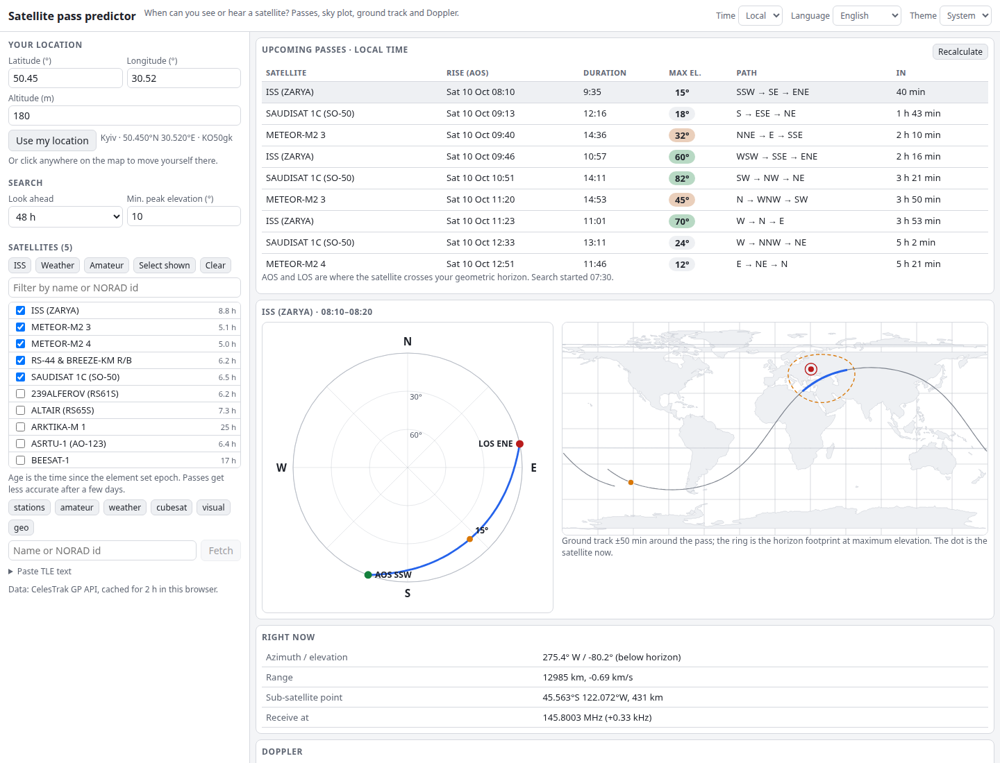

# Satellite Pass Predictor

When can you see or hear the ISS, a weather satellite or an amateur radio satellite from where you are? Pick your location, choose satellites, and get the next passes with rise and set times (AOS/LOS), peak elevation, a polar sky plot, a ground-track world map and the Doppler shift for a frequency you choose. Element sets come live from CelesTrak, or you can paste your own TLEs. Everything is computed in your browser.

**Try it: [hermes98761234.github.io/satellite-pass-predictor](https://hermes98761234.github.io/satellite-pass-predictor/)**

[](https://github.com/hermes98761234/satellite-pass-predictor/actions/workflows/deploy.yml)



## Features

- **Pass list** for the next 12 h to 7 days, merged across all selected satellites: AOS, duration, peak elevation (colour-coded), compass path and a countdown. Filter by minimum peak elevation.
- **Polar sky plot** of the selected pass (north up, zenith in the centre) with AOS, LOS, peak and the satellite's live position.
- **Ground track map** with the pass highlighted, the horizon footprint at peak elevation and the live sub-satellite point. Click the map to move your location.
- **Doppler**: enter a downlink (and optionally an uplink) in MHz, or use the built-in defaults for ISS, SO-50, RS-44, FO-29, AO-7, AO-73, Meteor-M and NOAA APT. You get a shift curve, a table at AOS / peak / LOS, the frequency to receive on, and the frequency to transmit on.
- **Every CelesTrak satellite**: all ~17 000 active satellites in one click, plus all 47 CelesTrak groups (stations, military, radar calibration, weather, Earth resources, SAR, Starlink, OneWeb, Kuiper, Qianfan, Iridium, GPS, GLONASS, Galileo, BeiDou, amateur, CubeSats, science, debris clouds and more). Look up any object by name or NORAD id, or paste TLE text. Element sets are cached for 2 h in the browser, and a bundled sample covers offline first load.
- **Filter by type and country**: pick a type (for example *Military*, *Weather* or *GPS operational*) and/or a country or operator (from the CelesTrak SATCAT owner field, cached for a week), then combine with a name filter. Each satellite in the list shows its owner code.
- **Location** by browser geolocation, typed coordinates or a map click; Maidenhead locator shown.
- **English and Ukrainian**, light, dark or system theme, local time or UTC. Settings are remembered in the browser; no backend, no tracking.

## How it works

Orbits are propagated with SGP4 ([satellite.js](https://github.com/shashwatak/satellite-js)) from two-line element sets. Positions are rotated into the Earth-fixed frame and converted to azimuth, elevation and range for your location. Passes are found by stepping every 30 s, then bisecting each horizon crossing to about half a second and refining the peak with a golden-section search. The search runs in a Web Worker.

Doppler uses the range rate (central difference over one second): the received frequency is `f(1 - rr/c)` and the transmit frequency that arrives at the satellite on its nominal uplink is `f / (1 - rr/c)`.

AOS and LOS are geometric horizon crossings (elevation 0°). Accuracy depends on the age of the element set: expect timing errors of seconds for fresh TLEs and minutes after a week or so. The coastlines are Natural Earth 110m land (public domain). Default frequencies are typical values; check the current operating status of a satellite before relying on them.

## Quick start

You need [Node.js](https://nodejs.org/) 22.

```bash
git clone https://github.com/hermes98761234/satellite-pass-predictor.git
cd satellite-pass-predictor
npm install
npm run dev       # http://localhost:5173
npm test          # SGP4 geometry, pass finder, Doppler, TLE parsing, i18n
npm run build     # static site in dist/
```

## License

MIT
